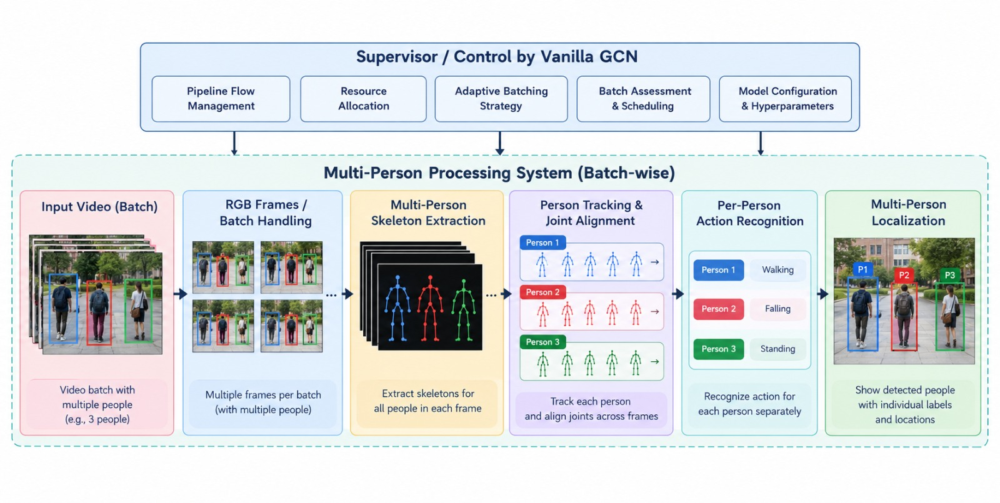
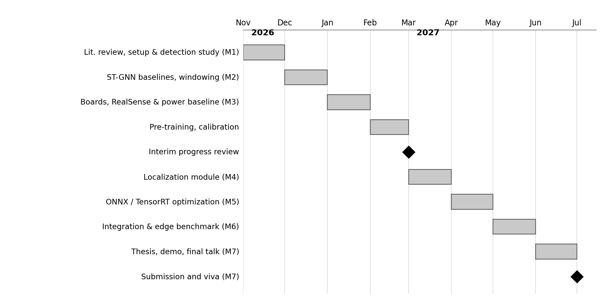

# FYP-lightweight-multiperson-action-recognition

Lightweight multi-person action recognition & temporal localization using ST-GNNs, deployed on edge hardware (Jetson Nano / Raspberry Pi 5).

## Overview

**ConnectIQ** is a lightweight, modular framework for recognizing and temporally localizing the actions of **multiple people simultaneously**, from either RGB or RGB-D (depth camera) video. Unlike existing toolkits such as MMAction2 and MMSkeleton — which fall short on multi-person support, temporal localization, or edge-device performance — this project combines all three: skeleton-based action recognition using ST-GNN models, a dedicated temporal localization module to find *when* each action starts and ends, and real deployment on low-cost edge hardware (NVIDIA Jetson Nano, Raspberry Pi 5). The framework also contributes two original modules: a pattern-aware **missing-joint recovery** system and an **adaptive multi-person batching** strategy, both designed to keep the pipeline lightweight even as the number of people in frame increases.

## Framework Architecture

*Fig. 1 — Proposed bottom-up, multi-person activity recognition and localization pipeline. A supervisor module (Vanilla GCN) controls pipeline flow, resource allocation, and adaptive batching across the multi-person processing stages: skeleton extraction → person tracking & joint alignment → per-person action recognition → multi-person localization.*

## Project Timeline

*Fig. 2 — Project timeline, October 2026 to June 2027.*

## Key Contributions

- **Missing-joint recovery** — a pattern-aware module that infers plausible joint positions from surrounding, correctly detected joints, without increasing the recognition model's computational cost.
- **Adaptive multi-person batching** — sizes each processing batch according to the number of people in the scene, available device memory, and a target latency budget.
- **Temporal action localization** — a second-stage module that refines window-level predictions into precise start/end times for each person's action.
- **Edge deployment** — benchmarked end-to-end on a desktop PC, an NVIDIA Jetson Nano, and (stretch target) a Raspberry Pi 5, after post-training pruning and quantization.

## Team

| Name | Role |
|---|---|
| A.J.L. Remingan | Action recognition, model training, pruning/calibration |
| K. Ravichandran | Tracking, action localization, quantization |
| Thavapalaratnam T. | Pose estimation, hardware & edge deployment |

**Supervisor:** Mr. Sanka Mohottala · **Co-supervisors:** Ms. A. Amarasinghe, Dr. U. Wijenayake

## Reports & Presentations

**CO4002 (Computer Engineering) Department**
- [Proposal Report](docs/reports/CO-department/CO4002_Proposal_Report.pdf)
- [Proposal Presentation](docs/reports/CO-department/CO4002_Presentation.pdf)

**EEE Department**
- [Proposal Report](docs/reports/EEE-department/EEE_Proposal_Report.pdf)

## Status

🚧 Proposal stage complete — implementation in progress (Oct 2026 – Jun 2027).
